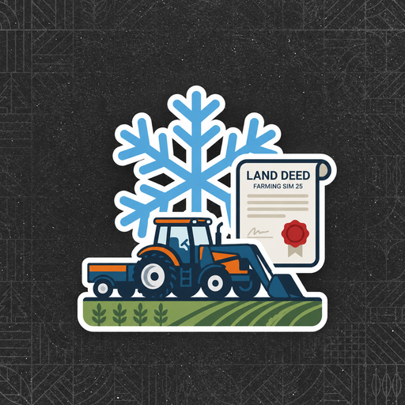

<p align="center">
  
</p>

<h1 align="center">Farm Freeze – Pauza dla Farm Offline</h1>

<p align="center">
  Mod multiplayer do <b>Farming Simulator 25</b>: gdy nikt, kto zarządza daną farmą, nie jest online, farma jest zamrożona do czasu powrotu kierownika.
</p>

<p align="center">
  
  
  
  <a href="https://discord.gg/gxwC8vUUch"></a>
</p>

<p align="center">
  <a href="README.md">English</a> · <b>Polski</b>
</p>

---

## Co to jest?

Grasz ze znajomymi, każdy na osobnej farmie, ale nie zawsze jesteście online w tym samym czasie. Gdy tylko jeden gracz przeskakuje czas, farmy nieobecnych żyją dalej: saldo spada przez koszty, maszyny się starzeją i tracą wartość, zwierzęta rosną, pasza się kończy, kredyty się spłacają.

**Farm Freeze to zatrzymuje.** Farma, której wszyscy kierownicy są offline, zostaje wstrzymana, a wszystko, co do niej należy, stoi dokładnie tak, jak było. Gdy kierownik wróci na serwer, farma sama się odmraża i rusza od miejsca, w którym stanęła.

> ID moda: `FS25_FreezeInactiveFarm` · Autor: **billiD**

## Co jest zamrażane

Dopóki żaden kierownik farmy nie jest online:

| Obszar | Co jest zamrożone |
|---|---|
| Konto bankowe | Przychody, koszty i opłaty nie zmieniają salda |
| Kredyty | Brak odsetek i rat; saldo kredytu i pozostały okres się nie zmieniają (także kredyty z modu *Bank & Credit*) |
| Maszyny | Wiek i motogodziny |
| Zwierzęta | Starzenie, rozmnażanie i zmiany zdrowia |
| Pasza, woda, słoma | Zużycie w oborach farmy |
| Produkcja obór | Mleko, jajka, wełna i inne produkty na paletach |
| Obornik i gnojowica | Produkcja w oborach farmy (osobny przełącznik) |

Pola, fabryki i produkcja poza oborami **nie są** zamrażane.

## Funkcje

- Działa w całości **po stronie serwera**, bez konfiguracji.
- Farmy **odmrażają się automatycznie**, gdy tylko wejdzie któryś z ich kierowników.
- **Menu w ustawieniach gry** (Ustawienia → *Farm Freeze*) z głównym włącznikiem i osobnym przełącznikiem dla każdej funkcji, każdy z opisem.
- Ustawienia zmienia tylko **admin serwera**; zmiany synchronizują się ze wszystkimi graczami i są zapisywane między sesjami.
- Menu po **angielsku i po polsku** (zależnie od języka gry; w każdym języku innym niż polski wyświetla się po angielsku).
- Zgodny z modami **Bank & Credit** i **Enhanced Animal System** (szczegóły niżej).

## Zgodność z innymi modami

| Mod | Status | Uwagi |
|---|---|---|
| Bank & Credit (`FS25_BankCredit`) | ✅ Zgodny | Raty, odsetki i prowizje są pomijane dla zamrożonych farm, a zaciąganie, spłacanie i wypłacanie kredytu jest dla nich zablokowane. |
| Enhanced Animal System | ✅ Zgodny | W tym modzie zwierzęta mogą umierać, więc na zamrożonej farmie muszą mieć jakieś jedzenie i wodę (jeśli woda jest wymagana) – zobacz [Dobrze wiedzieć](#dobrze-wiedzieć). |
| Animal Planner (`FS25_AnimalPlanner`) | ❌ Niezgodny | Przy zainstalowanym Animal Planner zwierzęta nie generują palet ani produktów (jajka, mleko, wełna itp.). |

Mody przebudowujące logikę obór lub bankowości mogą nie być w pełni obsłużone. Jeśli znajdziesz taki, który się gryzie, [zgłoś to](../../issues/new?template=bug_report.md).

## Instalacja

1. Pobierz `FS25_FreezeInactiveFarm.zip` ze strony [Releases](../../releases) (albo z GIANTS ModHub, gdy mod zostanie tam opublikowany).
2. Wrzuć ZIP – **nie rozpakowuj go** – do folderu z modami:
   - Windows: `Dokumenty\My Games\FarmingSimulator2025\mods`
   - macOS: `~/Library/Application Support/FarmingSimulator2025/mods`
3. **Serwer dedykowany:** wgraj ZIP do folderu modów serwera i uruchom serwer ponownie.
4. Włącz mod przy tworzeniu lub wczytywaniu zapisu.

> ⚠️ **Wersja moda musi być identyczna na serwerze i u każdego gracza.** Różne wersje mogą zepsuć synchronizację ustawień i wieku maszyn.

## Ustawienia

Otwórz **Ustawienia → Farm Freeze** w menu gry. Admini serwera mogą zmieniać przełączniki; inni gracze je widzą, ale nie zmienią.

| Przełącznik | Czego dotyczy |
|---|---|
| Farm Freeze: mod aktywny | Główny włącznik. Gdy wyłączony, żadna farma nie jest zamrażana, niezależnie od pozostałych przełączników. |
| Zamrażaj konto bankowe | Saldo konta farmy. |
| Zamrażaj kredyty | Odsetki i raty kredytu (także w Bank & Credit). |
| Zamrażaj wiek maszyn | Wiek i motogodziny maszyn farmy. |
| Zamrażaj czas zwierząt | Starzenie, rozmnażanie i zdrowie zwierząt farmy. |
| Zamrażaj pasze, wodę i produkcję obór | Zużycie paszy, wody i słomy oraz produkcja mleka, jajek i wełny. |
| Zamrażaj obornik i gnojowicę | Produkcja obornika i gnojowicy w oborach farmy. |

Ustawienia są zapisywane na serwerze w pliku `modSettings/FS25_FreezeInactiveFarm.xml` (w folderze profilu serwera). Domyślnie wszystkie przełączniki są włączone.

## Dobrze wiedzieć

- **„Zamrożone” znaczy zamrożone.** Dopóki żaden kierownik farmy nie jest online, wszystko z listy wyżej stoi w miejscu – *nawet jeśli gra inny członek tej farmy, który nie jest kierownikiem*. Zmiany pieniędzy w tym czasie są cofane.
- **Farma bez żadnego kierownika jest zamrożona na stałe.**
- **Zwierzęta potrzebują paszy i wody.** Zamrożenie zachowuje to, co obora zawiera, ale niczego nie uzupełnia. W Enhanced Animal System zwierzęta bez paszy lub bez wody (tam, gdzie jest wymagana) mogą nadal tracić zdrowie i umierać na zamrożonej farmie, więc zaopatrz obory przed wyjściem z serwera.
- **Mod nie cofa przeszłości.** Kredyt, który się spłacił, albo obornik, który się wyprodukował, zanim mod został zainstalowany lub gdy farma nie była zamrożona, nie wróci.
- Farma odmrożona z pustym korytem będzie głodować jak każda inna.

## Jak to działa

Mod działa na serwerze i raz na sekundę sprawdza każdą farmę. Farma jest *zamrożona*, gdy żaden z jej kierowników nie jest połączony. Dla zamrożonej farmy:

- **Pieniądze** – saldo jest zapamiętywane w chwili zamrożenia, a każda zmiana jest cofana. **Kredyty** – zapamiętany kredyt jest przywracany; w *Bank & Credit* miesięczne pobranie raty jest pomijane w całości (inaczej pieniądze wróciłyby, a kapitał kredytu już by zmalał).
- **Maszyny** – wiek i motogodziny są przywracane na serwerze, a serwer wysyła klientom listę zamrożonych farm, które przywracają je także lokalnie (klienci sami liczą wiek maszyn, więc na serwerach dedykowanych jest to potrzebne).
- **Zwierzęta** – godzinowe, dzienne i miesięczne zdarzenia obór są blokowane.
- **Pasza, woda, słoma** – poziomy są zapamiętywane, a każdy spadek jest przywracany przez funkcje obory z gry.
- **Produkcja** – stawki produkcji są zerowane, czynniki produkcji w obliczeniach wyjścia są zerowane, a poziomy palet nie mogą rosnąć. Obornik powstaje w części obory odpowiedzialnej za słomę (`outputLitersPerHour`), gnojowica w części z gnojowicą; obie są zerowane pod własnym przełącznikiem.

Nic nie jest zapisywane w pliku zapisu gry; ustawienia leżą w folderze `modSettings` serwera.

## Rozwiązywanie problemów

Szukaj tych linii w `log.txt` po wczytaniu mapy (na serwerze dedykowanym: w logu serwera):

```
[FarmFreeze] Mod zaladowany (wersja 1.0.7.0).
[FarmFreeze] Zgodnosc z Bank & Credit: aktywna (...)      <- tylko gdy Bank & Credit jest zainstalowany
```

- Pierwsza linia potwierdza, która wersja jest uruchomiona. Jeśli jej brak lub pokazuje inną wersję, gra używa innego pliku.
- Każdy problem wewnątrz moda jest zapisywany jako `[FarmFreeze] BLAD ...`; dołącz te linie do zgłoszenia błędu.
- Szczegółowe logi diagnostyczne włączysz, ustawiając na początku `FarmFreeze.lua` `FarmFreeze.DEBUG = true` (rozpakuj mod, zmień plik i spakuj ponownie, z plikami w głównym katalogu archiwum).

## Zgłaszanie błędów

[Otwórz zgłoszenie](../../issues/new?template=bug_report.md) i podaj:

- wersję moda i wersję gry,
- gra jednoosobowa, multiplayer hostowany przez gracza czy serwer dedykowany,
- listę zainstalowanych modów (szczególnie zwierzęta, banki i czas),
- czego oczekiwałeś i co się stało,
- linie `[FarmFreeze]` z `log.txt`.

Możesz też zapytać na [serwerze Discord](https://discord.gg/gxwC8vUUch).

## Dla programistów

Układ repozytorium:

```
modDesc.xml              deskryptor moda (wersja, opisy, lista zmian)
FarmFreeze.lua           logika: zamrażanie, przywracanie, hooki, zgodność z Bank & Credit
FarmFreezeGui.lua        menu ustawień, tłumaczenia, synchronizacja ustawień
FarmFreezeStateSync.lua  lista zamrożonych farm: serwer → klienci
icon.png                 ikona moda
```

ZIP moda buduj z plikami w **głównym katalogu** archiwum (nie w podfolderze):

```bash
zip FS25_FreezeInactiveFarm.zip modDesc.xml FarmFreeze.lua FarmFreezeGui.lua FarmFreezeStateSync.lua icon.png
```

## Autor

Stworzył **billiD** ([@billid-dev](https://github.com/billid-dev)).

## Licencja

Copyright © 2026 billiD. Wszelkie prawa zastrzeżone, chyba że plik `LICENSE` w tym repozytorium stanowi inaczej.
